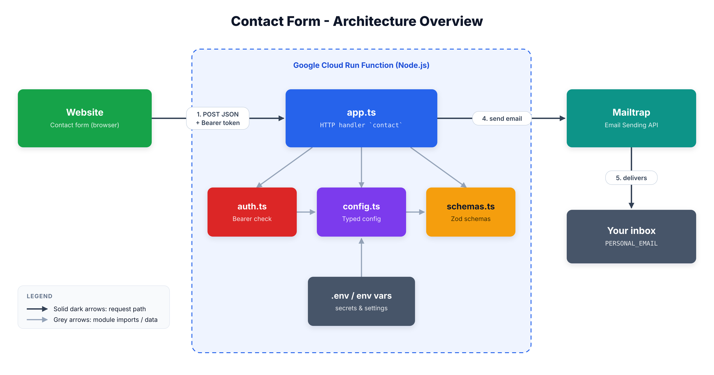
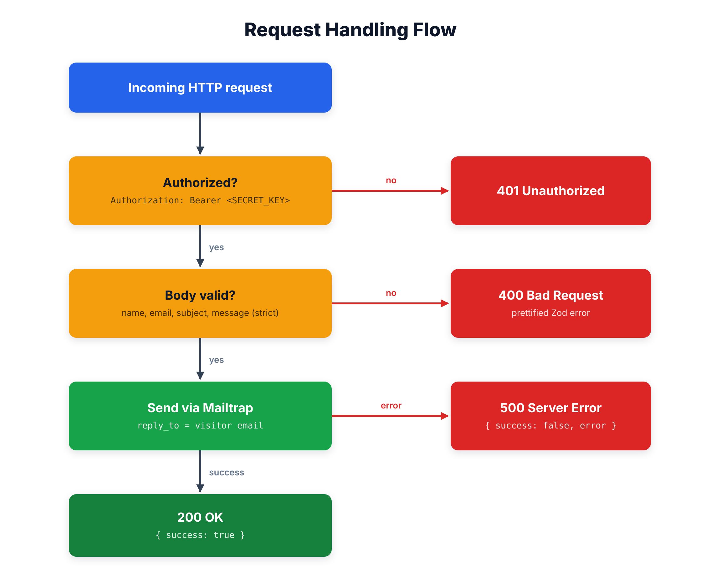
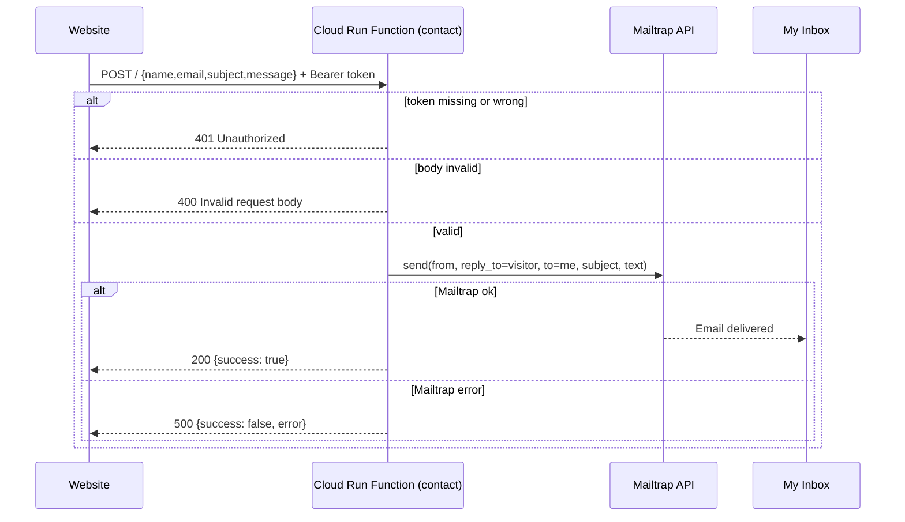

# Contact Form – Google Cloud Run Function


## Summary

A small, serverless HTTP endpoint that receives the contents of the contact form on my website and forwards them to my personal inbox as an email. It is written in TypeScript, bundled with esbuild, and runs as a **Google Cloud Run function** using the Functions Framework. Emails are delivered through the **Mailtrap** Email Sending API.

## Objective

- Accept contact-form submissions (`name`, `email`, `subject`, `message`) from my website without needing a dedicated server or database.
- Protect the endpoint so only my website can use it (shared-secret Bearer token).
- Reject malformed or unexpected input before anything is sent (strict schema validation).
- Deliver a readable email to my personal address, with **Reply-To** set to the visitor so I can answer with one click.
- Fail fast at start-up if any required configuration is missing or invalid.

## Architecture



## How It Works (General Steps)

1. **Website → function:** the site sends `POST` with a JSON body and an `Authorization: Bearer <SECRET_KEY>` header.
2. **Authorize:** the function compares the token to `SECRET_KEY` using a constant-time comparison. Failure → `401`.
3. **Validate:** the body is checked against a strict Zod schema (unknown fields are rejected). Failure → `400` with a readable error.
4. **Send:** the function calls Mailtrap to email `PERSONAL_EMAIL`, with the visitor's address as `reply_to`. Failure → `500`.
5. **Respond:** on success the function returns `200 { "success": true, "message": "Email sent successfully" }`.



<details>
<summary>Same flow as a sequence diagram (Mermaid)</summary>



</details>

## Project Structure

```text
contact-form/
├── src/
│   ├── app.ts        # Function entry point (HTTP handler "contact")
│   ├── auth.ts       # Bearer-token authorization
│   ├── config.ts     # Loads and validates environment variables
│   └── schemas.ts    # Zod schemas: environment + request body
├── docs/images/      # Diagrams used in this README
├── dist/             # Build output (git-ignored, generated by esbuild)
├── .env              # Local secrets (git-ignored)
├── package.json      # Scripts and dependencies
└── tsconfig.json     # Strict TypeScript configuration
```

## What Each File Does

| File | Purpose | Key exports / functions |
| --- | --- | --- |
| [src/app.ts](src/app.ts) | Entry point. Creates the Mailtrap client and registers the HTTP function named `contact`. Orchestrates authorize → validate → send → respond. | `contact` handler (registered with `gcFunctions.http`) |
| [src/auth.ts](src/auth.ts) | Checks the `Authorization` header and compares the token against `SECRET_KEY` without leaking timing information. | `isAuthorized(req)`, `safeEqual(a, b)` (internal) |
| [src/config.ts](src/config.ts) | Loads `.env` (via `dotenv`), validates `process.env` with `EnvSchema`, and exposes a typed, grouped config object. Throws on start-up if invalid. | `config` |
| [src/schemas.ts](src/schemas.ts) | Single source of truth for data shapes: environment variables and incoming request body. | `EnvSchema`, `RequestBodySchema` |
| [package.json](package.json) | Scripts, dependencies, ESM (`"type": "module"`), entry (`main: dist/app.js`). | – |
| [tsconfig.json](tsconfig.json) | Strict type-checking only (`noEmit`); esbuild produces the JS. Defines the `@/*` → `src/*` path alias. | – |

### Function reference

| Function | File | Description | Returns |
| --- | --- | --- | --- |
| `contact(req, res)` | `app.ts` | HTTP handler: auth check → body validation → send email → JSON/text response. | `401` / `400` / `200` / `500` |
| `isAuthorized(req)` | `auth.ts` | Parses `Authorization: Bearer <token>` and verifies the token. | `boolean` |
| `safeEqual(a, b)` | `auth.ts` | Constant-time string comparison (`timingSafeEqual`); rejects empty or different-length values. | `boolean` |
| `EnvSchema.parse(process.env)` | `config.ts` / `schemas.ts` | Validates and coerces environment variables, applying defaults. | typed env object |

## API Reference

**`POST /`** (function name: `contact`)

Headers:

```http
Authorization: Bearer <SECRET_KEY>
Content-Type: application/json
```

Body (all fields required; extra fields are rejected):

| Field | Type | Rules |
| --- | --- | --- |
| `name` | string | min length 1 |
| `email` | string | valid email address |
| `subject` | string | may be empty |
| `message` | string | min length 1 |

Responses:

| Status | When | Body |
| --- | --- | --- |
| `200` | Email accepted by Mailtrap | `{ "success": true, "message": "Email sent successfully" }` |
| `400` | Body fails validation | `Invalid request body: <details>` |
| `401` | Missing/invalid Bearer token | `Unauthorized Access Detected` |
| `500` | Mailtrap call failed | `{ "success": false, "message": "Failed to send email", "error": "<reason>" }` |

The email I receive looks like:

```text
From:     <MAILTRAP_SENDER_NAME> <MAILTRAP_SENDER_EMAIL>
To:       <PERSONAL_EMAIL>
Reply-To: <visitor's email>
Subject:  <subject from the form>

You have been contacted by <name> (<email>)

Here is their message:
<message>
```

## Configuration

Settings are read from environment variables (a local `.env` file is loaded automatically with `dotenv`) and validated at start-up.

| Variable | Required | Default | Description |
| --- | --- | --- | --- |
| `SECRET_KEY` | ✅ | – | Shared secret the website sends as the Bearer token. Must be non-empty, otherwise every request is rejected with `401`. |
| `MAILTRAP_API_TOKEN` | ✅ | – | Mailtrap API token. |
| `MAILTRAP_SENDER_NAME` | ✅ | – | Display name of the sender. |
| `MAILTRAP_SENDER_EMAIL` | ✅ | – | Sender address (must be a verified Mailtrap sending domain). |
| `PERSONAL_EMAIL` | ✅ | – | Inbox that receives the messages. |
| `HOST` | ❌ | `127.0.0.1` | Parsed into `config.server.host`; currently not used by the Functions Framework. |
| `PORT` | ❌ | `8080` | Parsed into `config.server.port` (integer ≥ 1023); the Functions Framework reads `PORT` itself. |

Example `.env` (never commit real values; `.env` is git-ignored):

```dotenv
SECRET_KEY=a-long-random-string
MAILTRAP_API_TOKEN=your-mailtrap-token
MAILTRAP_SENDER_NAME=My Website
MAILTRAP_SENDER_EMAIL=hello@your-verified-domain.com
PERSONAL_EMAIL=me@example.com
PORT=8080
```

Generate a strong secret with: `openssl rand -hex 32`

## Getting Started

**Prerequisites:** Node.js 24+, npm, a [Mailtrap](https://mailtrap.io) account with a verified sending domain, and (for deployment) the [gcloud CLI](https://cloud.google.com/sdk/docs/install).

```bash
npm install          # install dependencies
npm run build        # clean → typecheck → bundle into dist/app.js
npm start            # serve the function locally at http://localhost:8080
```

Test locally (this sends a real email):

```bash
curl -X POST http://localhost:8080 \
  -H "Authorization: Bearer $SECRET_KEY" \
  -H "Content-Type: application/json" \
  -d '{"name":"Jane Doe","email":"jane@example.com","subject":"Hello","message":"Nice website!"}'
```

### npm scripts

| Script | What it does |
| --- | --- |
| `npm run build` | Runs `clean`, `typecheck`, then `bundle`. |
| `npm run clean` | Deletes `dist/`. |
| `npm run typecheck` | `tsc --noEmit` strict type-check. |
| `npm run bundle` | esbuild bundles `src/app.ts` to `dist/app.js` (ESM, Node 24, source maps, dependencies kept external). |
| `npm start` | `functions-framework --target=contact` (run `build` first). |
| `npm run gcp-build` | Hook executed by Google Cloud Build during deployment; runs `build`. |

## Security Notes

- **Shared secret:** requests without the exact Bearer token get `401`; comparison is constant-time.
- **Strict validation:** `z.strictObject` rejects unexpected fields; emails are format-validated.
- **Fail-fast config:** missing or invalid environment variables stop the function from starting.
- **No secrets in git:** `.env`, `dist/` and `node_modules/` are git-ignored.
- **Call it from a server, not the browser:** the function sends no CORS headers, and embedding `SECRET_KEY` in client-side JavaScript would expose it. Call the endpoint from your website's backend (or a serverless proxy) and keep the key server-side.

## Tech Stack

| Technology | Role |
| --- | --- |
| [Google Cloud Run functions](https://cloud.google.com/functions) + [Functions Framework](https://github.com/GoogleCloudPlatform/functions-framework-nodejs) | Serverless hosting and local runner |
| [TypeScript](https://www.typescriptlang.org/) | Strict typing |
| [esbuild](https://esbuild.github.io/) | Fast bundling to `dist/app.js` |
| [Zod](https://zod.dev) | Schema validation for env vars and request body |
| [Mailtrap](https://mailtrap.io) (`mailtrap` SDK) | Email delivery |
| [dotenv](https://github.com/motdotla/dotenv) | Local environment loading |
